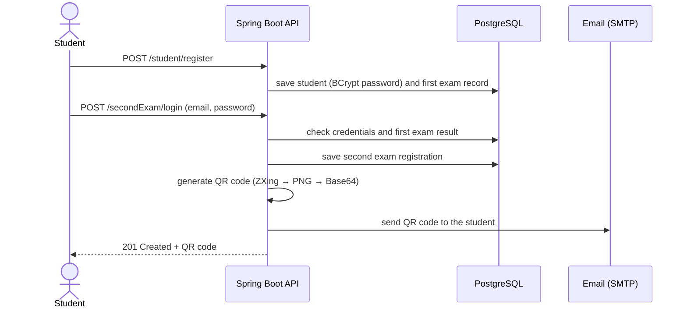

<p align="center">
  
  
  
  
</p>

# Student Exam QR System

A Spring Boot backend for a two-stage exam.
Students register in the system. A student who passed the first exam can sign up for the second exam: the system checks the first exam result, creates the registration, generates a QR code and sends it to the student by email.

## Tech stack

Java 21 · Spring Boot 4 · Spring Data JPA · PostgreSQL · Spring Security (BCrypt) · Bean Validation · Java Mail · ZXing · Lombok · Gradle

## How it works



## API

| Method | Endpoint | Description |
|---|---|---|
| `POST` | `/student/register` | Registers a student. Email must be unique, password is stored as a BCrypt hash. |
| `POST` | `/secondExam/login` | Checks the student's credentials and first exam result, registers the student for the second exam and returns the QR code. |

**Register**

```json
POST /student/register
{
  "name": "Aysel",
  "surname": "Mammadova",
  "email": "aysel@example.com",
  "password": "secret123"
}
```

**Second exam registration**

```json
POST /secondExam/login
{
  "email": "aysel@example.com",
  "password": "secret123"
}
```

## Error handling

Errors are handled in one place with `@RestControllerAdvice`.

| Exception | HTTP status | When |
|---|---|---|
| `EmailAlreadyExistsException` | 409 Conflict | The email is already registered |
| `InvalidCredentialsException` | 401 Unauthorized | Wrong email or password |
| `ExamNotPassedException` | 403 Forbidden | The first exam was not passed or not found |
| `QrAlreadyExistsException` | 409 Conflict | The student is already registered for the second exam |
| `MethodArgumentNotValidException` | 400 Bad Request | The request body is not valid (field errors are returned in `data`) |

## Project structure

```text
src/main/java/com/example/studentexamproject
├── config        # Spring Security configuration (password encoder)
├── controller    # StudentController, SecondExamController
├── dto           # request / response DTOs
├── exceptions    # custom exceptions and global handler
├── model/entity  # Student, FirstExam, SecondExam
├── repository    # Spring Data JPA repositories
└── service       # registration, authentication, QR code and email logic
```

## Getting started

**Requirements:** JDK 21, PostgreSQL (or Docker)

**1. Start PostgreSQL**

```bash
docker run --name exam-db -e POSTGRES_PASSWORD=postgres -e POSTGRES_DB=exam_db -p 5432:5432 -d postgres:16
```

**2. Set environment variables**

| Variable | Example |
|---|---|
| `URL` | `jdbc:postgresql://localhost:5432/exam_db` |
| `USERNAME` | `postgres` |
| `DB_PASSWORD` | `postgres` |
| `MAIL_USERNAME` | Gmail address used to send emails |
| `MAIL_PASSWORD` | Gmail app password |

**3. Run**

```bash
./gradlew bootRun
```

## What I practiced in this project

- Layered architecture (Controller → Service → Repository)
- Password hashing with BCrypt and credential checks
- Business rules: only students who passed the first exam can register for the second one
- Generating QR codes with ZXing and sending emails with Java Mail
- Centralized error handling with custom exceptions

## Roadmap

- QR code check at the exam entrance (scan → verify registration)
- Role-based access for admins and students
- Endpoint for entering exam results
- Unit tests for the service layer

## Author

**Mehriban Nüsrətova** — Junior Java Backend Developer
[LinkedIn](https://www.linkedin.com/in/mehriban-nusratova) · [GitHub](https://github.com/MehribanNusretova)
